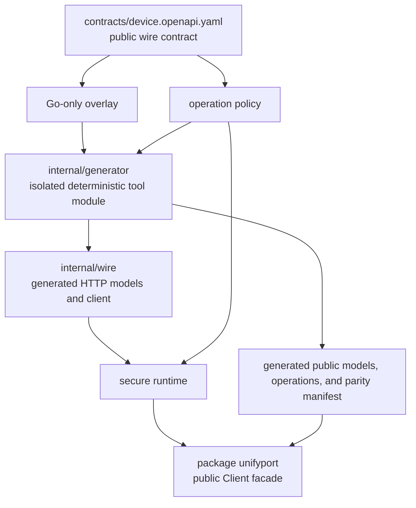

# Architecture

[English](architecture.md) | [简体中文](zh-CN/architecture.md)

## Goals and scope

The UnifyPort Go SDK turns the approved public Device API contract into an idiomatic, maintainable Go
client. It has four design goals:

- complete operation and schema coverage without hand-written path drift;
- one secure runtime for authentication, URL, retry, timeout, response, and error behavior;
- a stable public facade that does not expose generator or transport internals;
- deterministic generation and language-neutral parity metadata for ongoing maintenance.

Only public Device API capabilities are in scope. Provider-account management, authorization, and
runtime routes under `/v1/accounts/...` belong to the same client. MCP, generic raw HTTP access,
provider-specific orchestration, and an unspecified webhook signature algorithm are outside this
repository.

## Layered design

Each layer has one responsibility:

| Layer | Responsibility | Boundary |
| --- | --- | --- |
| Contract | Method, path, parameters, bodies, responses, schemas, and authentication | Only approved public protocol input |
| Go overlay | Apply the one approved response-component rename | Fail-closed; no other target/key/value or type override |
| Operation policy | Retry, mutability, secret, and destructive classifications | Unknown operations use strict defaults |
| Generator module | Validate inputs and deterministically produce wire/facade/parity artifacts | Separate `go.mod`; never part of the consumer runtime graph |
| Generated wire | Encode and decode contract-defined HTTP messages | Kept under `internal/` |
| Secure runtime | Authentication, URL scope, redirect, timeout, retry, limits, parsing, and errors | No operation can bypass it |
| Public facade | Idiomatic requests, results, errors, call options, and pagination | Supported consumer API |

## Public facade

The module root uses `package unifyport` and exposes `Client`. Construction validates the complete
configuration before the first request. Operation methods use `context.Context`, Go names with common
initialisms (`API`, `ID`, `QR`), and operation-specific request structs when an operation accepts input.

The public facade intentionally does not expose:

- the generated `internal/wire` client;
- arbitrary method/path/base-URL or raw request functions;
- per-call authentication headers;
- options that expand the configured timeout, retry, or response-size budget.

This keeps future generator changes internal while preserving one reviewable transport policy.

## Generated and hand-written responsibilities

Generated assets are derived from the checked-in contract, Go overlay, and language-neutral operation
policy. They carry a generated marker and are never edited directly. Generation owns repetitive facts:

- wire models and parameter types;
- operation method/path mappings;
- public facade operation wrappers;
- preflight guards for representable OpenAPI `dependentRequired` constraints;
- public model aliases or projections;
- the parity manifest and coverage counts.

The generator and `oapi-codegen` tool versions are isolated in `internal/generator/go.mod`. The root
runtime module consumes checked-in generated Go code only: the OpenAPI document is not embedded, and
generator-only libraries do not enter a normal consumer's module graph.

Hand-written code owns behavioral invariants that a general OpenAPI generator cannot infer safely:

- configuration normalization and credential scope;
- redirect refusal, request deadlines, cancellation, retry, and backoff;
- bounded response reading and error redaction;
- explicit no-content behavior and cursor pagination;
- stable public error categories.

## Call lifecycle

Every operation follows the same sequence:

1. Apply generated preflight constraints, such as `dependentRequired`, without serializing secrets into
   an error or performing credential/network work.
2. Resolve call options and start the shared timeout budget at the `executeOperation` execution entry.
3. Build and marshal the contract-defined request synchronously, then reject an expired budget before
   credential lookup or HTTP.
4. Resolve the configured API-key provider once using the remaining budget.
5. Send `X-Api-Key` through the redirect-disabled transport and retry only when policy opts in and the
   failure is temporary; every attempt and backoff inherits the same deadline.
6. Read the response through the configured byte limit under that deadline.
7. Parse synchronously, then check the same deadline before accepting parsed data.
8. Return typed data plus safe response metadata, or a stable typed error with filtered fields.

The same resolved credential is reused for retry attempts. Cancellation promptly stops context-aware
credential, HTTP, response-read, and backoff work and prevents a new attempt. Synchronous build,
`MarshalJSON`, and parse code is not forcefully preempted; it may return after the deadline, at which
point the SDK returns `TimeoutError` and discards success.

## Results and errors

A successful operation preserves every contract-defined envelope field across `Result[T]`: business
data is in `Data`, envelope request identifiers have dedicated fields, and transport metadata includes
the status plus a filtered header snapshot. A `204` response uses an explicit no-content representation
rather than an ambiguous zero value. Public results do not provide a raw response object that could
make sensitive headers part of routine logging. If the public envelope gains a field, generation and
parity checks must extend `Result[T]` instead of silently dropping it.

Errors are separated into configuration, network, timeout, cancellation, API, response-parse, and
pagination categories. API errors retain only a filtered status, API code, request ID, and operation
ID. Raw bodies, headers, upstream messages/details, provider errors, and underlying causes are not part
of the public error graph.

## Timeout and retry

The client has a finite global deadline budget. Per-call options may disable retry or tighten a
deadline or retry count; they cannot increase the global budget. The budget covers request build,
credential lookup, HTTP/retry, bounded body reading, and parsing without being reset at the transport
boundary. Automatic retry is driven by explicit operation policy, never inferred solely from `GET` or
another HTTP method.

Eligible operations may retry transport failures and `408`, `429`, `502`, `503`, or `504`. A valid
bounded `Retry-After` takes precedence; otherwise the runtime uses capped full jitter. Writes,
destructive operations, authorization submissions, and one-time-secret operations are not retried by
default.

## Integer and pagination boundaries

Go can represent exact 64-bit integers, so generated models use explicit integer or string types based
on the public schema rather than JavaScript-safe-number normalization. Contract changes still require
range review: callers must not silently narrow an `int64` or `uint64` to `int`.

Cursor pagination is opt-in. The pager does not prefetch, checks `context.Context` before continuing,
enforces a maximum page count, rejects repeated cursors, and rejects `has_more=true` without a usable
next cursor.

## Release boundary

The repository is the source distribution for the Go module. A release consists of a reviewed Git
tag after deterministic generation, tests, race detection, vet, static analysis, vulnerability
scanning, documentation review, and public-content scanning all pass. Real staging/provider end-to-end
verification is tracked as a separate release gate; offline tests do not substitute for it.

See [contract maintenance](contract-maintenance.md), [security](security.md),
[Node parity](node-parity.md), and [release process](release.md) for operational details.
