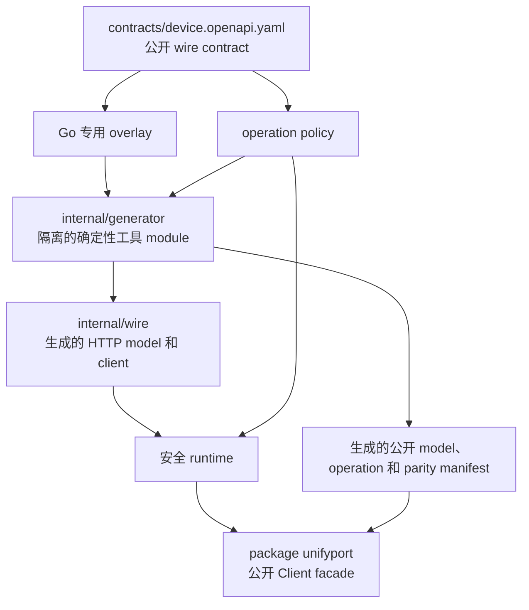

# 架构

[English](../architecture.md) | [简体中文](architecture.md)

## 目标与范围

UnifyPort Go SDK 把已批准的公开 Device API 契约转换为符合 Go 习惯且易维护的 client，包含四个设计目标：

- 完整覆盖 operation 和 schema，避免手写 path 漂移；
- 使用统一安全 runtime 处理认证、URL、retry、timeout、response 和 error 行为；
- 提供稳定 public facade，不暴露 generator 或 transport 内部实现；
- 通过确定性生成和语言中立 parity 元数据降低长期维护成本。

本仓库只包含公开 Device API 能力。`/v1/accounts/...` 下的 provider 账号管理、授权和运行态路由属于同一个
client。MCP、通用 raw HTTP 访问、provider 专用编排，以及契约尚未定义的 webhook 签名算法不在本仓库范围内。

## 分层设计

每一层只承担一种职责：

| 层 | 职责 | 边界 |
| --- | --- | --- |
| Contract | method、path、parameter、body、response、schema 和认证 | 唯一已批准公开协议输入 |
| Go overlay | 应用唯一已批准 response-component 重命名 | Fail-closed；禁止其他 target/key/value 或 type override |
| Operation policy | retry、mutability、secret 和 destructive 分类 | 未知 operation 采用严格默认值 |
| Generator module | 校验输入并确定性生成 wire/facade/parity 制品 | 独立 `go.mod`；不进入 consumer runtime graph |
| Generated wire | 编解码契约定义的 HTTP 消息 | 保留在 `internal/` |
| Secure runtime | 认证、URL scope、redirect、timeout、retry、limit、解析和 error | 所有 operation 都必须经过 |
| Public facade | 符合 Go 习惯的 request、result、error、call option 和 pagination | 受支持的 consumer API |

## Public facade

module 根目录使用 `package unifyport` 并公开 `Client`。构造 client 时，在首次请求之前完整校验配置。
Operation method 使用 `context.Context`、包含常用 initialism（`API`、`ID`、`QR`）的 Go 名称；需要输入的
operation 使用独立 request struct。

Public facade 有意不暴露：

- 生成的 `internal/wire` client；
- 任意 method/path/base URL 或 raw request 方法；
- 单次调用可覆盖认证的 header；
- 可扩大全局 timeout、retry 或 response-size 预算的 option。

这样可以把未来 generator 变化封装在内部，并保持唯一、可审查的 transport policy。

## 生成与手写职责

生成物只来自仓库内契约、Go overlay 和语言中立 operation policy，带 generated 标记且不得手改。生成负责
维护重复事实：

- wire model 和 parameter type；
- operation method/path 映射；
- public facade operation wrapper；
- 可表达的 OpenAPI `dependentRequired` 约束对应的前置 guard；
- public model alias 或 projection；
- parity manifest 和覆盖数量。

Generator 与 `oapi-codegen` 工具版本隔离在 `internal/generator/go.mod`。Root runtime module 只消费已提交的
生成 Go 代码：不嵌入 OpenAPI 文档，正常 consumer module graph 也不包含 generator-only library。

通用 OpenAPI generator 无法安全推断的行为不变量由手写代码负责：

- 配置规范化和 credential scope；
- redirect 拒绝、request deadline、cancellation、retry 和 backoff；
- 有界 response 读取和 error 脱敏；
- 明确的 no-content 行为和 cursor pagination；
- 稳定公开 error 分类。

## 调用生命周期

每个 operation 都遵循相同流程：

1. 应用生成的前置约束（如 `dependentRequired`），不把 secret 序列化到 error，也不执行 credential/network work。
2. 解析 call option，并在 `executeOperation` 执行入口启动共享 timeout 预算。
3. 同步构建并 marshal 契约定义的 request；完成后若预算已过期，在 credential lookup 或 HTTP 前拒绝继续。
4. 使用剩余预算解析一次配置的 API-key provider。
5. 通过禁止 redirect 的 transport 发送 `X-Api-Key`；只有 policy 允许且错误属于临时错误时才重试，所有 attempt
   和 backoff 继承同一 deadline。
6. 在该 deadline 下通过配置的字节上限读取 response。
7. 同步解析 response，并在接受 data 前再次检查同一 deadline。
8. 返回 typed data 和安全 response 元数据，或只包含过滤字段的稳定 typed error。

Retry attempt 复用同一个已解析 credential。Cancellation 会及时停止可感知 context 的 credential、HTTP、
response read 和 backoff，并阻止新的 attempt。同步 build、`MarshalJSON` 和 parse 不会被强制抢占；它们可能在
deadline 后才返回，此时 SDK 返回 `TimeoutError` 并丢弃成功结果。

## Result 与 error

成功 operation 会在 `Result[T]` 中保留契约定义的全部 envelope 字段：业务数据位于 `Data`，envelope request
identifier 使用独立字段，transport 元数据包括 status 和过滤后的 header snapshot。`204` 使用明确的
no-content 表达，避免含糊的零值。公开 result 不提供 raw response object，防止常规日志意外携带敏感 header。
若公开 envelope 新增字段，generation/parity check 必须扩展 `Result[T]`，不能静默丢弃。

错误分为 configuration、network、timeout、cancellation、API、response-parse 和 pagination 类别。API error
只保留过滤后的 status、API code、request ID 和 operation ID。Raw body/header、上游 message/details、
provider error 和底层 cause 不进入公开 error graph。

## Timeout 与 retry

Client 有有限全局 deadline 预算。单次调用 option 可以关闭 retry，或收紧 deadline/retry 次数，但不能增加
全局预算。预算覆盖 request build、credential lookup、HTTP/retry、有界 body read 和 parse，且不会在
transport 边界重置。自动重试由显式 operation policy 决定，不能仅根据 `GET` 或其他 HTTP method 推断。

可重试 operation 可以重试 transport failure 以及 `408`、`429`、`502`、`503`、`504`。合法且在上限内的
`Retry-After` 优先，否则 runtime 使用有上限的 full jitter。写操作、destructive operation、授权提交和
一次性 secret operation 默认不重试。

## 整数与 pagination 边界

Go 可以精确表示 64-bit integer，因此生成 model 根据公开 schema 使用明确的 integer 或 string，而不需要
JavaScript safe-number 归一化。契约变化仍要审查范围；调用方不能把 `int64` 或 `uint64` 静默缩窄为 `int`。

Cursor pagination 需要显式使用。Pager 不预取；继续请求前检查 `context.Context`，并限制最大页数、拒绝重复
cursor，以及拒绝 `has_more=true` 但没有可用 next cursor 的响应。

## Release 边界

仓库是 Go module 的源码分发渠道。只有确定性生成、测试、race detection、vet、静态分析、漏洞扫描、文档复核
和公开内容检查全部通过，才能由维护者审查并创建 Git tag。真实 staging/provider 端到端验证是独立 release
gate；离线测试不能替代它。

操作细节见[契约维护](contract-maintenance.md)、[安全](security.md)、[Node parity](node-parity.md)和
[发布流程](release.md)。
